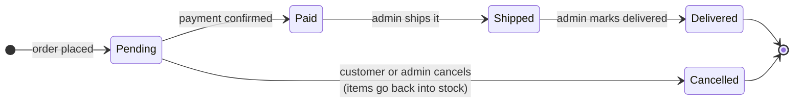

# Vendora: What We've Built So Far

_Last updated: 2026-10-13_

## What Vendora is

Vendora is an online marketplace for clothing: many sellers list products, customers buy them, and a store team runs the whole thing. It works end to end today — a customer can browse, add items to a cart, pay by card through Stripe, and track their order.

Three kinds of people use it:

| Who | What they do | Where they go |
| --- | --- | --- |
| Customer | Browses, buys, tracks and cancels their own orders | The store, cart, checkout, My orders |
| Seller | Lists their own products and sees orders for them | Seller dashboard (/seller) |
| Store team (admin) | Runs everything: all orders, products, categories and users | Admin panel (/admin) |

Under the hood there are two parts: a **website** people click around in, and a **server** that holds the data and enforces the rules. The website can hide a button, but the server is what actually says yes or no — so every rule in this document is enforced on the server.

## Accounts and roles

Anyone can create an account with an email and a password; every new account starts as a customer.

- **Register:** email plus a password of at least 8 characters. First and last name are optional. Passwords are stored scrambled (hashed), never as plain text.
- **Log in:** email and password. A wrong email and a wrong password give the same answer and take the same time, so nobody can test which emails have accounts.
- **Staying logged in:** logging in gives the browser a pass (a token) that lasts 15 minutes by default. The browser sends it with every request.
- **When the pass expires:** the website notices, signs you out, and takes you to the login page instead of showing broken errors. (This was fixed on 2026-10-10 — before, expired users just saw errors.)
- **Banned accounts:** an admin can ban a user. A banned user can't log in, and any pass they already hold stops working.

Every account has one role, and the server checks it on every request:

| Role | Can do |
| --- | --- |
| Customer | Shop, pay, see and cancel their own pending orders |
| Seller | Everything a customer can, plus list and edit **their own** products and see orders for them |
| Admin | Everything, across all sellers and customers |
| Super admin | Same as admin, the top level |

Only admins can change someone's role (for example, to make a customer a seller). Role changes take effect on the user's very next request, because the server re-reads the account each time.

## Shopping

Customers can browse without an account; they only need to log in at checkout.

- **Home page:** a banner, a strip of categories, and a grid of products. Draft and archived products are left out — the server never sends them to the shop.
- **Categories:** clicking a category (on the strip or in the header menu) shows only that category's products. Clicking it again goes back to all products.
- **Search:** the search box in the header finds products whose name or description contains the words typed, ignoring capital letters.
- **Pages:** the shop shows 12 products per page, newest first, with Previous and Next buttons under the grid. The page and category are in the web address (for example `/?category=…&page=2`), so the back button, refreshing and shared links all keep your place. Choosing a category or searching starts again at page 1.
- **Product page:** each product has its own page (by its slug, the short web-address name like `classic-blue-jeans`) with photo, description, size, price and an Add to cart button. Out-of-stock products can't be added.
- **Prices:** shown in whole US dollars (for example $55.00). Cents are not used.
- **Cart:** items, quantities and the running total. You can change quantities or remove items. The cart is saved in your browser, so it survives a page refresh, but it isn't tied to your account — a different device has a different cart.
- **Prices in the cart are for display only.** When you actually order, the server looks up the current price itself, so an old or edited cart can't change what you pay.

## Checkout and payment

Checkout happens in two steps: Vendora first creates the order and sets the items aside, then sends you to Stripe to pay.

1. **Review:** the checkout page lists your cart and the total. You must be logged in; if not, you're sent to the login page.
2. **Place order:** you click "Place order & pay". The server checks every item is still for sale and in stock, takes the items out of stock, and saves the order as **Pending** (waiting for payment). If any item is short, nothing is ordered and you see which item ran out.
3. **Pay:** you're sent to Stripe's secure payment page. Vendora never sees your card number.
4. **Confirmation:** Stripe tells Vendora's server directly when the payment succeeds, and the order changes to **Paid**. Because this message comes from Stripe and is signature-checked, nobody can fake a payment by visiting a web page.
5. **Back on Vendora:** you land on a success page (with links to your orders and the shop) or a cancel page if you backed out.

Your cart empties as soon as the order is created, because the items are already reserved for you. If you leave without paying, the order stays Pending and you can pay or cancel it later from **My orders**.

## My orders

Every logged-in user can see their own order history under **My orders** in the account menu (added 2026-10-10).

- **Order list (/orders):** newest first, 20 per page. Each row shows a short order number, the date, how many items, a coloured status label and the total. Brand-new users see a "Start shopping" button instead.
- **Order page (/orders/…):** every item with its photo, size, price and quantity, plus the total and the status.
- **Complete payment:** shown only while an order is Pending. It sends you back to Stripe to pay for that order.
- **Cancel order:** also shown only while Pending. After you confirm, the order becomes **Cancelled** and its items go back into stock so others can buy them.
- **Paid orders can't be cancelled by the customer yet,** because that needs a refund, which isn't built.
- **Privacy:** you only ever see your own orders. Asking for someone else's order gives "Order not found" — the same answer as an order that doesn't exist, so nobody can guess other people's order numbers.
- **Up to date:** the pages re-check with the server each time you open them, so a status change (payment received, shipped) shows without logging out and in.

## Seller dashboard

Sellers get their own area at **/seller** (added 2026-10-10), reached from **Seller dashboard** in the account menu. It only ever shows the logged-in seller's own products and sales. Admins can open it too and see their own listings.

**Dashboard page** — five numbers at a glance, plus the five latest orders:

| Number | What it counts |
| --- | --- |
| Revenue | Money from your items in orders that are Paid, Shipped or Delivered |
| Orders | Orders that include at least one of your items (cancelled ones not counted) |
| Paid, awaiting shipment | Orders with your items that are paid but not yet shipped |
| Active products | Your products currently for sale |
| Low stock (5 or fewer) | Your for-sale products with 5 or fewer left |

**My products page**

- Lists all your products, including drafts and archived ones, with search and a status filter.
- **New product** and **Edit** open the same form the admin uses: name, web-address name, description, price, stock, status, size, category and image link.
- **Archive** hides a product from the shop but keeps it, so past orders still show it. **Restore as draft** brings it back.
- **There is no Delete for sellers.** Only admins can permanently delete a product.
- You can only change your own products. Trying to edit another seller's product is refused by the server.

**Orders page**

- Lists orders that contain your products, with a status filter.
- **You only see your part of each order.** If a customer bought from you and from another seller in one order, you see just your items and your subtotal — not the other seller's items, not the order's full total, and not the customer's details.
- **Read-only:** sellers can't change an order's status. One order can hold items from several sellers but has a single status, so the store team manages it.

## Admin panel

The store team runs everything from **/admin**, reached from **Admin panel** in the account menu. Only admins and super admins can open it, and the server checks this on every action. Every list has search, filters and pages of 20.

- **Dashboard:** total revenue (Paid, Shipped and Delivered orders), number of orders, orders waiting for payment, number of customers, products for sale, products with 5 or fewer left, and the 5 latest orders. Clicking a number opens the matching list.
- **Orders:** every order from every customer. Search by order number or customer email; filter by status. Admins move orders along (Paid → Shipped → Delivered) or cancel pending ones. Moves that make no sense are refused (see the order flow in the next section).
- **Products:** every product from every seller, in any status. Create, edit, archive, and permanently delete. A product that appears in past orders can't be deleted, because those orders still point to it; archive it instead.
- **Categories:** create, rename and delete categories. Two categories can't share the same web-address name.
- **Users:** every account, with search and filters by role and status. Admins can change a user's role (for example make them a seller) and ban or un-ban them.
- **Safety limits on users:** nobody can change their own account here, only a super admin can make someone an admin, and only a super admin can change another admin.

## Behind the scenes: the rules that keep things safe

These rules run on the server, so they hold no matter which page, app or script sends the request.

**Order status rules.** An order can only move along the arrows below. Anything else — for example Delivered back to Pending, or cancelling a paid order — is refused with a clear message.

Payment is normally confirmed by Stripe; admins can also mark a pending order as paid by hand.

- **No overselling.** When two people buy the last item at the same moment, only one order succeeds; the other is told the item is out of stock. Stock is only taken if enough is still there at that exact instant.
- **Stock comes back exactly once.** Cancelling a pending order returns its items to stock. If two cancel requests arrive together, only one goes through, so stock is never added back twice.
- **No silent overwrites.** If two admins change the same order's status at the same moment, the second one is told the order changed and asked to retry, instead of quietly undoing the first.
- **Sellers can only touch their own products.** Editing or archiving someone else's product is refused. Only admins can permanently delete products.
- **Editing one field changes only that field.** Updating just a product's price leaves its stock alone. (Before 2026-10-10, a price-only update reset stock to 0.)
- **Unique web-address names.** Two products, or two categories, can't share the same slug. Trying gives "A record with this slug already exists" instead of a crash.
- **Clear error messages.** Errors say what went wrong ("email must be an email", "product not found") and carry a code the website understands, such as not logged in, not allowed, or not found. Internal details like file paths are hidden in production.
- **Whole-dollar prices.** Prices, order totals and line prices are whole US dollars. The server rejects prices with cents, and Stripe is charged the dollar amount times 100 (Stripe counts in cents).
- **Customers can't see others' data.** Order pages return "not found" for anyone else's order, and sellers never see customer details or other sellers' items.

## What changed on 2026-10-10

This session closed a security hole, fixed several bugs, added safety rules, and added two features: My orders and the seller dashboard. Every change was tested against the real database.

| Type | Change | In plain words |
| --- | --- | --- |
| Feature | Seller dashboard | Sellers get /seller with their stats, products and orders (only their own items) |
| Rule | Only admins can delete products | Sellers archive instead, so order history stays intact |
| Security fix | Sellers limited to their own products | Before, any seller could edit or delete any other seller's products |
| Feature | My orders | Customers see their orders, pay for pending ones, or cancel them |
| Feature | Customer can cancel a pending order | Items go back into stock automatically |
| Bug fix | Expired logins now sign you out | Before, users with an expired pass were stuck on broken pages |
| Bug fix | Clear error messages and codes | "Not found" no longer looks like "server crashed"; form errors say which field is wrong |
| Bug fix | Editing a product no longer wipes its stock | A price-only update used to reset stock to 0 |
| Rule | Order status rules | Orders only move forward; cancelling returns stock exactly once |
| Rule | Category web-address names are unique | Duplicates are refused with a clear message instead of a crash |
| Clean-up | Prices declared as whole dollars everywhere | The API used to advertise decimal prices it would then reject |

## Before using today's changes, and what's next

Restart the backend server first — it is still running yesterday's code. The other items below are open work, roughly in priority order.

**Housekeeping**

- [ ] Restart the backend so it picks up today's changes.
- [ ] Optionally remove test data from the local database: users with emails starting `claude-test-` or `claude-probe`, the archived test products `aaa` and `bbb`, and one paid test order (it adds $70 to the admin revenue figure).
- [ ] Commit the rest of today's work — the first fixes are committed, but My orders, the seller dashboard and the later fixes (30 changed files) are not.

**Gaps found along the way**

- [x] **Draft and archived products are hidden by the server** (fixed 2026-10-11). The shop's product list and product pages only return products that are for sale or out of stock; a draft or archived product's web address says "product not found". Sellers and admins still see them in their own dashboards.
- [x] **The shop's product list has pages** (fixed 2026-10-13). The server sends 12 products at a time and filters by category itself, so the shop stays fast as the catalogue grows.
- [ ] **Abandoned checkouts keep items reserved.** When Stripe reports an expired checkout, the payment code should call the existing "cancel order" step so stock comes back. (This sits in the payment code, which you are building yourself.)
- [ ] **No automated tests yet.** Today's checks were run by hand against the database.

**Next features (need a decision first)**

- [ ] **Profile and password:** an /account page to change name and password (current password required). Suggested: no email changes until email verification exists.
- [ ] **Forgot password:** needs an email-sending service such as Resend or SendGrid.
- [ ] **Product photo uploads:** today sellers paste an image link. Suggested: upload straight from the browser to Cloudinary or Amazon S3, which needs an account and keys.
- [ ] **Later:** refunds (so paid orders can be cancelled), and per-seller shipping, so each seller marks their own part of an order as shipped.
